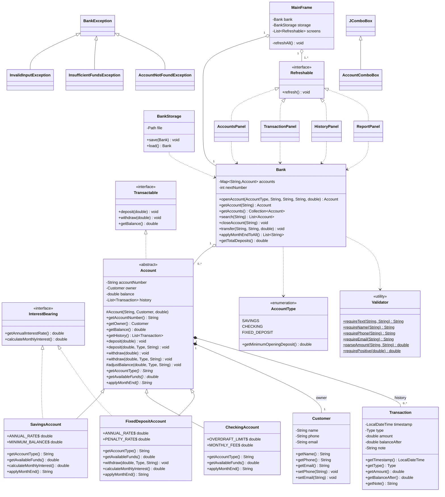

# Java Banking System (Swing GUI)

A GUI banking application built with Java Swing that demonstrates the Four Pillars of OOP.

## Run in GitHub Codespaces
1. Push this folder to a GitHub repository, then **Code → Codespaces → Create codespace**.
2. Wait for the container to build (it installs Java 21 and a browser-based desktop).
3. In the terminal run: `./run.sh`
4. Open the **Ports** tab, click the globe icon next to port **6080** (Desktop noVNC). Password: `vscode`.
5. The Banking System window appears inside that desktop.

Run the automated checks with `./test.sh`.
Run locally (JDK 17+): `./run.sh`

## System features (9)
1. Open account (Savings / Checking / Fixed Deposit)
2. View all accounts
3. Search accounts (number, name, type)
4. Deposit
5. Withdraw
6. Transfer between accounts
7. View transaction history
8. Month-end processing (interest / fees)
9. Close account and bank summary report

Data is saved automatically to `data/bank.dat`.

## Project structure
```
src/bank/
  Main.java
  exception/  BankException, InvalidInputException, InsufficientFundsException, AccountNotFoundException
  model/      Account (abstract), SavingsAccount, CheckingAccount, FixedDepositAccount,
              Transactable, InterestBearing, Customer, Transaction, AccountType
  service/    Bank, BankStorage
  util/       Validator, Money
  gui/        MainFrame, AccountsPanel, TransactionPanel, HistoryPanel, ReportPanel,
              AccountComboBox, Refreshable, Ui
  test/       BankTests
```

## OOP implementation (for your documentation and defense)

| Pillar | Where | Explanation |
|---|---|---|
| **Encapsulation** | `Account`, `Customer`, `Transaction` | All fields are `private`. `balance` has a getter but **no setter**; it only changes through `deposit`/`withdraw`/`adjustBalance`, which validate first. `Transaction` is immutable (`final` fields, no setters). `getHistory()` returns an unmodifiable list. |
| **Inheritance** | `Account` → `SavingsAccount`, `CheckingAccount`, `FixedDepositAccount`; `AccountComboBox extends JComboBox<Account>`; exceptions extend `BankException` | Children reuse the parent's account number, owner, balance, history, `deposit` and `withdraw`, and add only what differs. |
| **Polymorphism** | `getAvailableFunds()`, `applyMonthEnd()`, `getAccountType()` (overriding); `FixedDepositAccount.withdraw(...)` (overrides parent rule); `Bank.applyMonthEndToAll()`; `MainFrame` refreshing `Refreshable` screens | `Bank` calls `account.applyMonthEnd()` on an `Account` reference: Savings credits interest, Checking charges a fee, Fixed Deposit credits higher interest. `FixedDepositAccount` overrides `withdraw` to add a 2% penalty. |
| **Abstraction** | abstract class `Account`; interfaces `Transactable`, `InterestBearing`, `Refreshable` | `Account` cannot be instantiated and forces each subclass to define its own rules. `InterestBearing` is implemented only by Savings and Fixed Deposit. `Refreshable` lets every screen be redrawn without `MainFrame` knowing the concrete panel. |

### Account rules
| Type | Min. opening | Withdrawal rule | Month-end |
|---|---|---|---|
| Savings | PHP 500 | Must keep PHP 500 minimum balance | +3% p.a. interest (monthly) |
| Checking | PHP 1,000 | Overdraft up to PHP 5,000 | PHP 50 fee if balance < PHP 5,000 |
| Fixed Deposit | PHP 5,000 | 2% early-withdrawal penalty | +6% p.a. interest (monthly) |

## UML class diagram
GitHub renders this automatically. You can also paste it into https://mermaid.live to export an image for your documentation.



## Input validation and error handling
| Check | Where |
|---|---|
| Required fields (name, contact, email, amount) | `Validator.requireText` |
| Name / phone / email format | `Validator.requireName / requirePhone / requireEmail` |
| Numeric amount, > 0, max, 2 decimals | `Validator.parseAmount / requirePositive` |
| Minimum opening deposit per type | `Bank.openAccount` |
| Insufficient funds / minimum balance / overdraft / penalty | `Account.withdraw`, `FixedDepositAccount.withdraw` |
| Transfer to same account, unknown account | `Bank.transfer`, `Bank.getAccount` |
| Cannot close account with balance | `Bank.closeAccount` |
| All errors shown as dialogs, never a crash | `Ui.guard` |

## Testing evidence
`./test.sh` runs 20 automated checks (T01-T20) covering opening accounts, validation, deposits, withdrawals,
overdraft, penalties, transfers, search, closing, month-end polymorphism, and history. Last result: **20 passed, 0 failed**.
For your documentation, also take GUI screenshots of: each tab, a successful transaction, and at least two error dialogs
(e.g. empty name, withdrawing too much) and paste them in the Testing section.

## Documentation checklist (Section XI of your project sheet)
Title: *Java Banking System* · Description · Problem statement (manual banking is slow and error-prone) · Objectives ·
System features (list above) · OOP implementation (table above) · UML (above) · GUI screenshots (you take them) · Testing · Conclusion.
